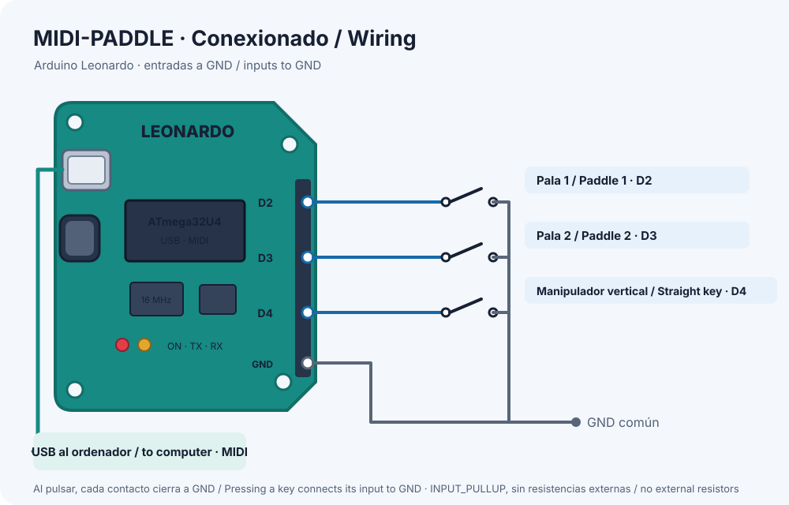

# MIDI-PADDLE

*[English below](#english)*

## Español

MIDI-PADDLE convierte un Arduino Leonardo en una interfaz USB MIDI para manipuladores de telegrafía (CW). Admite un manipulador de palas (iambic o de una pala) y un manipulador vertical.

La placa se conecta al ordenador como un dispositivo MIDI estándar, sin drivers. Cada vez que se pulsa o se suelta un contacto, envía una nota MIDI. Así puede usarse con cualquier programa que acepte entrada MIDI, como entrenadores de Morse, osciladores de práctica o aplicaciones web con Web MIDI.

| Entrada              | Pin | Nota MIDI |
|----------------------|-----|-----------|
| Pala 1               | D2  | C4 (60)   |
| Pala 2               | D3  | C#4 (61)  |
| Manipulador vertical | D4  | D4 (62)   |

Cada entrada va entre su pin y GND, sin componentes externos.

Las instrucciones de montaje, compilación y flasheo están en [LEEME_MIDI_KEY.md](LEEME_MIDI_KEY.md).

## English

MIDI-PADDLE turns an Arduino Leonardo into a USB MIDI interface for telegraphy (CW) keys. It supports a paddle key (iambic or single-lever) and a straight key.

The board connects to the computer as a standard MIDI device, with no drivers needed. Every time a contact is pressed or released, it sends a MIDI note. This makes it usable with any software that accepts MIDI input, such as Morse trainers, practice oscillators or web apps using Web MIDI.

| Input        | Pin | MIDI note |
|--------------|-----|-----------|
| Paddle 1     | D2  | C4 (60)   |
| Paddle 2     | D3  | C#4 (61)  |
| Straight key | D4  | D4 (62)   |

Each input is wired between its pin and GND, with no external components.

Wiring, build and flashing instructions are in [README_MIDI_KEY.md](README_MIDI_KEY.md).

## Archivos / Files

- [midikeyer.ino](midikeyer.ino): firmware / sketch
- [LEEME_MIDI_KEY.md](LEEME_MIDI_KEY.md): instrucciones en castellano
- [README_MIDI_KEY.md](README_MIDI_KEY.md): instructions in English
